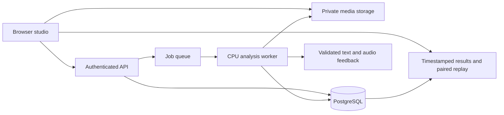

# MIMORA production and infrastructure plan

**From imitation to mastery.**

Prepared 28 October 2026. This is a deployment recommendation and capacity estimate, not infrastructure already provisioned. Start with a limited music pilot; validate new skill domains before enabling automated judgments.

## 1. Two launch paths

### Launch the current app as a browser-first beta

The current studio can be served as static files from `dist/`. Processing and saved history remain in the learner's browser. It needs no database, GPU, API keys, or persistent server. The existing private Site already provides this experience.

For your own domain, connect the GitHub repository to Cloudflare Pages. Use framework preset None, repository root `/`, build command `exit 0`, output directory `dist`, and production branch `main`. Configure a domain you own and verify HTTPS. A domain name has not been purchased or checked for availability. Cloudflare's documentation supports static HTML projects and these build settings: https://developers.cloudflare.com/pages/framework-guides/deploy-anything/

GitHub Actions runs the syntax checks and 14 behavioral tests. Configure hosting branch controls/required checks before treating the pipeline as a release gate; the included workflow alone does not prevent a hosting service from deploying a failing commit.

The static deployment does not run `server.mjs`. Spoken playback uses device speech; downloadable WAV requires the local server. There are no cross-device accounts or cloud video libraries yet. Keep those limits explicit in the beta.

### Launch a managed pilot with accounts and durable assessments — recommended next

Add the following services as the backend is implemented. Keep local-only practice available. Do not route FFmpeg or model inference through a static host or a short-lived web request.

| Component | Recommended initial service | Purpose |
|---|---|---|
| Frontend + DNS + TLS | Cloudflare Pages and your own domain | Serve the existing studio; deploy from GitHub |
| Accounts + application database | Supabase Auth and managed PostgreSQL | Users, experts, exercises, submissions, evidence, reviews and progress |
| Private recording storage | Supabase Storage initially | Expert clips, learner clips, audio proxies and feedback files, behind access policies |
| API | FastAPI container on Render | Validate sessions, authorize media access, create jobs, return results |
| Job queue | Redis-compatible managed queue with Celery or RQ | Decouple uploads from expensive processing; retry safely |
| Analysis workers | Separate CPU container on Render | FFmpeg, MIDI, alignment, Basic Pitch experiments and report generation |
| Audio feedback | Worker-based TTS | Produce downloadable WAV/MP3 from validated report text |
| Operations | Error tracking, structured logs, uptime and queue alerts | Detect failed assessments and control costs |
| Releases | GitHub Actions + staging/production separation | Tests, deployment checks and rollback |

Supabase requires appropriate row-level security on exposed tables. Recordings need equivalent storage policies. See its production checklist: https://supabase.com/docs/guides/deployment/going-into-prod

Render documents background workers for asynchronous media processing and queue-based execution: https://render.com/docs/background-workers

Use one storage provider initially. If migrating to AWS later, use private S3 with short-lived signed upload/download URLs; avoid proxying large video uploads through the API. Use unique server-generated keys to prevent overwriting another recording. AWS documents signed uploads here: https://docs.aws.amazon.com/AmazonS3/latest/userguide/PresignedUrlUploadObject.html

## 2. Request flow

The browser requests upload authorization, uploads media directly to storage, and submits a job. A worker validates the media, extracts events, aligns the attempt to the reference, and writes versioned findings. The API returns job status; the browser fetches completed evidence and signed replay links. Every critique keeps its source timestamps and measurement method. Explanation text cannot introduce new diagnoses.

## 3. Suggested starting capacity

These are engineering starting points to benchmark, not promises of throughput:

- API: 1 vCPU and 1–2 GB RAM.
- Worker: 2 vCPU and 4–8 GB RAM; one active model/media job per worker initially. Bound memory, subprocess time and media duration.
- PostgreSQL: small managed instance with connection pooling and daily backups. Keep recordings outside the database.
- Queue: small managed instance; reconstruct retryable jobs from database state after queue loss.
- Storage: 100 GB initially, with a retention policy chosen for the pilot.
- GPU: none for MIDI comparison and the initial CPU pipeline. Add isolated GPU workers only when a selected visual model and measured latency justify them.
- Keep API, database, queue, workers and storage in compatible nearby regions. Choose the region based on pilot users and data-residency needs.

For an illustrative 100-learner pilot, 10 attempts per learner per month at 20 MB per attempt is 20 GB of new learner media per month, before references, proxies and reports. At 90-day retention that is roughly 60 GB of original learner media. Actual video codecs, retention and replay frequency determine storage and egress costs.

## 4. Budget planning

The current static beta can use an entry-level static hosting plan; domain registration and any platform account costs are separate.

For a small CPU-only managed pilot, reserve approximately **US$100–250/month** as a planning allowance, excluding engineering, taxes, heavy media traffic, paid model APIs, GPU usage and expanded staging capacity. This is our estimate, not a bundled vendor quote. Break it into database/auth/storage, API compute, worker compute, queue, monitoring and bandwidth; then replace allowances with provider calculator quotes after load testing.

Supabase Pro currently starts at **US$25/month** with one project and included quotas; overages and compute upgrades cost more. Check the current plan before purchasing: https://supabase.com/pricing

Render service pricing depends on the selected machine and workspace plan; confirm the API and worker choices independently: https://render.com/pricing

## 5. Application changes required before cloud launch

1. Add sign-in, ownership and instructor/learner roles. Enforce authorization server-side on every exercise, recording, finding and export.
2. Replace localStorage as the primary cross-device record with database persistence. Preserve local-only practice as a separate choice.
3. Add signed direct uploads, a media completion check, duration/format validation and private replay URLs.
4. Introduce job IDs, idempotent retries, cancellation, timeouts, explicit failure states and per-user quotas.
5. Run FFmpeg and model jobs with restricted permissions and bounded resources. Cache reference features by media hash, model version and rubric version.
6. Move downloadable TTS behind authenticated API jobs. The current loopback-only `server.mjs` is a local convenience and must not be exposed as the production API.
7. Store evidence, model/rubric versions, instructor decisions and deletion state. Test that one user cannot retrieve another user's recording.
8. Add consent, deletion and retention controls covering originals, proxies, embeddings/features and generated reports. Test backup restoration and deletion behavior.
9. Benchmark note detection, alignment, abstention and feedback precision using independently labeled examples, including valid alternate techniques and obscured hands.
10. Test mobile recording/codecs, long jobs, low connectivity, failed model downloads, accessibility, load and costs. Add alerting for failed jobs, long queues and budget thresholds.

## 6. Release sequence

**First:** publish the renamed browser beta on your chosen domain and run a small consented music pilot. Keep automated audio conclusions marked possible and technique unassessed.

**Next:** implement the managed backend, cross-device history, private media and hosted audio export. Validate the audio models against the pilot corpus before expanding automatic scoring.

**Then:** add separately validated craft step recognition and pronunciation alignment. Treat each domain as its own perception/rubric/evaluation project. Add optional explanation models only after measurements and evidence validation are complete.

Do not begin with Kubernetes or an always-on GPU cluster. A static frontend, managed relational database, private object storage, one API and one queue-driven worker are sufficient to develop and benchmark the next pilot architecture.

## 7. Accounts and decisions needed from the owner

- A domain you own and a hosting account for it.
- One organization/project for database, authentication and media storage.
- One compute account for the API, queue and worker.
- Initial learner count, monthly attempts, clip duration/size, retention period, region and spending limit.
- Consent and instructor-review arrangements for the evaluation set.

Only the existing private Site and GitHub source repository are being updated in this task. No paid infrastructure, public access change, or domain purchase is implied by this plan.
